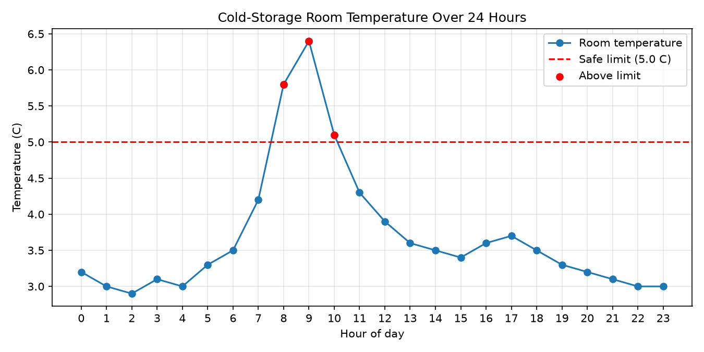

# BIT 2118 Scientific Computing

## Task A: NumPy Arrays and Numerical Computation

**Program file:** `code/Task_02_numpy_arrays.py`
**Output graph:** `output/cold_storage_plot.png`

---

## 1. Mathematical Concept

An **array** is an organized collection of numbers.

- A **vector** is a one-dimensional array: `v = [v1, v2, ..., vn]`
- A **matrix** is a rectangular array: `A = [aij]`

Scientific computing often applies **one operation to every element**. For example, if `x = [1, 2, 3]`, then `x² = [1, 4, 9]`. NumPy performs these operations directly on the whole array without a loop for each value (this is called vectorization).

## 2. Example

If the temperatures are `[20, 22, 24, 26]` °C, their mean is (20 + 22 + 24 + 26) / 4 = 23 °C. With NumPy, `np.mean(temperatures)` does this in one step.

## 3. Real-World Applications

1. Sensor readings from IoT devices
2. Image pixels
3. Network traffic measurements
4. Scientific measurements
5. Machine-learning feature matrices
6. Financial time series

## 4. Real-World Problem and Solution Approach

**Problem:** A weather station records 24 hourly temperatures. Store them in an array, calculate the daily mean, minimum and maximum, and convert all values from Celsius to Fahrenheit.

**Solution approach:** Represent the readings as one NumPy array. Use `mean()`, `min()` and `max()`, then apply `F = 1.8C + 32` to the entire array at once.

## 5. Solution Code

See `code/Task_02_numpy_arrays.py`.

### Output

```
Daily mean temperature: 23.12 C
Minimum temperature: 17.50 C
Maximum temperature: 29.40 C
First six Fahrenheit readings: [65.3  64.4  64.04 63.5  64.22 66.2 ]
```

**Interpretation:** The coolest hour was 17.5 °C and the warmest was 29.4 °C, giving a daily mean of 23.12 °C.

## 6. Changing the Inputs and Observing the Results

| Change made | Mean (°C) | Min (°C) | Max (°C) |
|-------------|-----------|----------|----------|
| Original | 23.12 | 17.50 | 29.40 |
| All readings + 10 °C | 33.12 | 27.50 | 39.40 |
| Highest reading changed to 60 °C | 24.40 | 17.50 | 60.00 |
| Constant 20 °C all day | 20.00 | 20.00 | 20.00 |
| All readings − 25 °C | −1.88 | −7.50 | 4.40 |

**Observations:**

- Adding or subtracting a constant shifts the mean, minimum and maximum by exactly that amount.
- One outlier (60 °C) raised the mean by about 1.3 °C and changed the maximum, while the minimum stayed the same. The mean is sensitive to extreme values.
- A constant day gives the same mean, minimum and maximum.

## 7. Related Real-World Case: Cold-Storage Room Monitoring

**Scenario:** A sensor records a cold-storage room's temperature every hour for 24 hours. Produce is safe only at or below 5.0 °C.

**Assumptions:**

1. One reading per hour for 24 hours.
2. Readings are in °C.
3. The safe limit is 5.0 °C.
4. The door is opened for deliveries around hours 8 to 10, so the temperature rises then.

**Approach:** Compare every reading with the limit using a boolean array (`room_c > SAFE_LIMIT_C`), count the `True` values with `np.sum()`, and plot the readings with the limit as a dashed line.

**Results:**

```
Mean temperature: 3.69 C (38.64 F)
Minimum temperature: 2.90 C
Maximum temperature: 6.40 C at hour 9
Safe limit: 5.0 C
Hours above the safe limit: 3
Hours where limit was exceeded: [ 8  9 10]
```

**Interpretation:** The room went above the safe limit at hours 8, 9 and 10, matching the delivery period, so the produce may be at risk. The door and cooling system should be checked.

**Changing an input:** With a stricter limit of 4.0 °C, the hours above the limit rise to 5.



## 8. How to Run

```bash
pip install numpy matplotlib
python code/Task_02_numpy_arrays.py
```