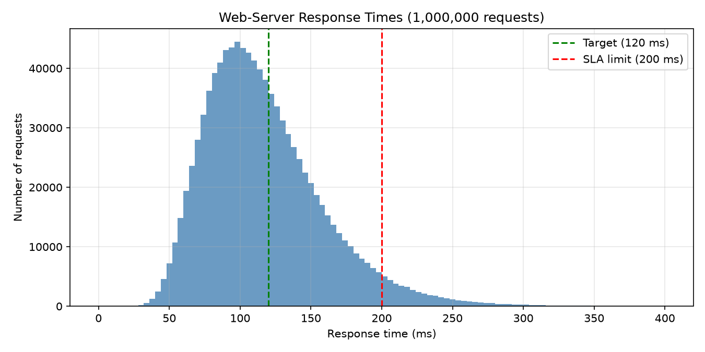
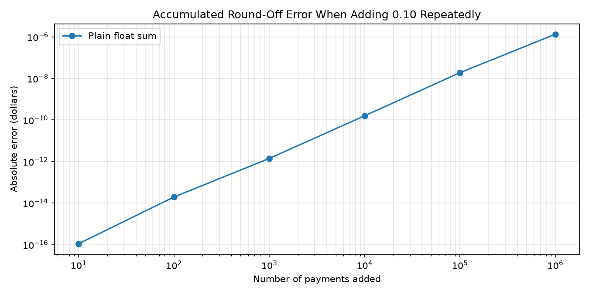

---

## Task B: Mathematical Functions and Vectorization

**Program file:** `code/Task_03_vectorization.py`
**Output graph:** `output/response_time_histogram.png`

### 1. Mathematical Concept

**Vectorization** means applying a mathematical operation to many values at the same time. If `yᵢ = sin²(xᵢ) + cos²(xᵢ)`, the identity gives `yᵢ = 1` for every `xᵢ`. Instead of looping through `x1, x2, ..., xn`, NumPy evaluates the whole vector in one expression. Vectorized code runs in compiled C code inside NumPy, which is why it is so much faster than a Python `for` loop.

### 2. Example

For `x = [0, π/2, π]`, `np.sin(x)` gives approximately `[0, 1, 0]`. The same operation works whether `x` has 3 values or one million values.

### 3. Real-World Applications

Large datasets, simulations, signal processing, image processing, numerical models, and machine learning, where millions of arithmetic operations are repeated.

### 4. Real-World Problem and Solution Approach

**Problem:** A network-monitoring system has one million latency measurements and needs to convert each from milliseconds to seconds and square the values for an error calculation.

**Solution approach:** Use vectorized NumPy expressions such as `seconds = latency_ms / 1000` and `squared = seconds ** 2`. This is simpler and usually much faster than Python loops.

### 5. Solution Code

See `code/Task_03_vectorization.py`. It contains both a loop version and a vectorized version, times them with `timeit`, and checks that they give the same answer.

**Output:**

```
First five squared latency values: [0.03787665 0.01266192 0.04637842 0.03092504 0.00078812]
Loop time: 0.1921 s
Vectorized time: 0.0067 s
Approximate speed-up: 28.5x
Loop and vectorized results match? True
```

**Interpretation:** Both methods give identical results, but the vectorized version is about 28 times faster on one million values (the exact speed-up depends on the computer).

### 6. Changing the Inputs and Observing the Results

| Change made | Result |
|-------------|--------|
| 100 values | Speed-up about 6x (too little data for vectorization to matter much) |
| 10,000 values | Speed-up about 85x |
| 1,000,000 values | Speed-up about 45x |
| Slow network (100 to 900 ms) | Mean squared latency rises from 0.0213 s² to 0.3032 s² |
| One outlier of 10,000 ms | Maximum squared value jumps from 0.0625 s² to 100 s², but the mean barely changes (0.021259 to 0.021359 s²) |
| Constant 100 ms | Every squared value is 0.01 s² |

**Observations:**

- Vectorization helps most on larger datasets. The speed-up varies between runs, but it is always large.
- Squaring magnifies large values, so a single outlier dominates the maximum squared error.
- Because squaring is a nonlinear operation, doubling the latency makes the squared value four times larger.

### 7. Related Real-World Case: Web-Server Response-Time Monitoring

**Scenario:** A web server logs the response time of one million requests. The target is 120 ms, and any response slower than 200 ms breaks the service agreement (SLA).

**Assumptions:**

1. The server logs one million response times in milliseconds.
2. The target response time is 120 ms.
3. Responses over 200 ms break the SLA.
4. Most requests are fast and a few are slow (modelled with a lognormal distribution).

**Approach:** Compute the error from the target, square it, and take the root mean squared error (RMSE), all as vectorized expressions. Use a boolean array (`response_ms > SLA_MS`) to count the slow requests.

**Results:**

```
Mean response time: 116.98 ms
Median response time: 110.08 ms
95th percentile: 195.59 ms
Root mean squared error vs 120 ms target: 42.30 ms
Requests slower than 200 ms: 43,665 (4.37%)
```

**Interpretation:** Only 4.37% of requests exceed 200 ms, so the server is performing acceptably. With a stricter limit of 150 ms, 18.83% of requests would be too slow.



### 8. How to Run

```bash
pip install numpy matplotlib
python code/Task_03_vectorization.py
```


---

## Task C: Floating-Point Arithmetic and Numerical Errors

**Program file:** `code/Task_04_numerical_errors.py`
**Output graph:** `output/roundoff_error_plot.png`

### 1. Mathematical Concept

Computers store most real numbers with a finite number of binary digits, so some values are only approximations.

- **Absolute error** = |true value − approximate value|
- **Relative error** = absolute error / |true value|
- **Truncation error** comes from replacing an exact mathematical process with an approximation.
- **Round-off error** comes from finite computer precision.

### 2. Example

If √2 = 1.41421356 but we use 1.414, the absolute error is about 0.00021356. The relative error is about 0.000151, or 0.0151%.

### 3. Real-World Applications

Scientific simulations, banking calculations, GPS/navigation, engineering design, iterative algorithms, and any system where accumulated numerical error can affect a result.

### 4. Real-World Problem and Solution Approach

**Problem:** A program compares `0.1 + 0.2` with `0.3` and unexpectedly reports `False`.

**Solution approach:** This happens because binary floating-point representation is approximate. Compare using `np.isclose()` or a suitable tolerance instead of exact equality.

### 5. Solution Code

See `code/Task_04_numerical_errors.py`. It shows the failed exact comparison, the tolerance-based fix, the absolute and relative error of an approximation of √2, and an unstable formula next to a stable rewrite of it.

**Output:**

```
0.1 + 0.2 = 0.30000000000000004
Exact comparison: False
Tolerance-based comparison: True
Absolute error: 0.00021356
Relative error: 0.01510114%

x=1e-04: direct=0.499987500624, stable=0.499987500625
x=1e-08: direct=0.499999996961, stable=0.499999998750
x=1e-12: direct=0.500044450291, stable=0.500000000000
```

**Interpretation:** `0.1 + 0.2` is stored as `0.30000000000000004`, so exact equality fails but `np.isclose()` succeeds. The direct formula `(√(1+x) − 1)/x` loses accuracy as `x` shrinks because it subtracts two nearly equal numbers (catastrophic cancellation). The algebraically equivalent form `1/(√(1+x) + 1)` avoids the subtraction and stays accurate.

### 6. Changing the Inputs and Observing the Results

**Other comparisons:**

| Test | Exact `==` | `np.isclose` |
|------|-----------|--------------|
| 0.5 + 0.25 == 0.75 | True | True |
| 0.1 * 3 == 0.3 | False | True |
| ten 0.1s added == 1.0 | False | True |
| 0.1 + 0.7 == 0.8 | False | True |

**Different approximations of √2:**

| Approximation | Absolute error | Relative error |
|---------------|----------------|----------------|
| 1.4 | 0.01421356 | 1.0051% |
| 1.41 | 0.00421356 | 0.2979% |
| 1.414 | 0.00021356 | 0.0151% |
| 1.41421 | 0.00000356 | 0.0003% |

**Unstable formula at more extreme `x`:**

| x | Relative error of direct formula |
|---|----------------------------------|
| 1e-04 | 2.0e-12 |
| 1e-08 | 3.6e-09 |
| 1e-12 | 8.9e-05 |
| 1e-15 | 1.1e-01 (11%) |
| 1e-16 | 1.0 (100%, the answer is 0) |

**Observations:**

- Numbers that are exact in binary (0.5, 0.25, 0.75) compare correctly. Numbers such as 0.1, 0.3 and 0.7 cannot be stored exactly, so exact equality is unreliable for them.
- Each extra correct digit in an approximation reduces the error, but it never reaches zero.
- The direct formula gets worse and worse as `x` shrinks, until at `x = 1e-16` it returns 0 because `1 + x` rounds to exactly 1. The stable formula is unaffected.

### 7. Related Real-World Case: Banking, Adding 10-Cent Payments

**Scenario:** A bank adds up one million payments of exactly $0.10. The exact total is $100,000.00.

**Assumptions:**

1. Every payment is exactly $0.10.
2. The exact total is n × 0.10.
3. Plain floats are compared with integer cents, `Decimal` and `math.fsum`.

**Approach:** Add the payments four different ways and compare each total with the exact value.

**Results:**

```
Plain float sum:      100000.0000013329  (error 1.33e-06)
Integer cents:        100000.0000000000  (error 0.00e+00)
Decimal:              100000.0000000000  (error 0.00e+00)
math.fsum:            100000.0000000000  (error 0.00e+00)
```

**Error of the plain float sum as the number of payments grows:**

| Payments | Error |
|----------|-------|
| 10 | 1.1e-16 |
| 1,000 | 1.4e-12 |
| 100,000 | 1.9e-08 |
| 1,000,000 | 1.3e-06 |

**Interpretation:** A tiny error in each addition accumulates, so the plain float total is wrong by about 0.0000013 dollars after a million payments. This is small, but a bank cannot accept it, and equality checks on the total would fail. Banks avoid it by storing money as integer cents or `Decimal`.



### 8. How to Run

```bash
pip install numpy matplotlib
python code/Task_04_numerical_errors.py
```

## Task D: Matrix Algebra and Matrix Operations

**Program file:** `code/Task_05_matrix_algebra.py`
**Output graph:** `output/task_05_diagram.png`

### 1. Mathematical Concept

A matrix organizes values in rows and columns. Matrix addition combines corresponding elements. Matrix multiplication combines rows of the first matrix with columns of the second: `cᵢⱼ = Σ aᵢₖ bₖⱼ`. The determinant indicates whether a square matrix is invertible (`det = 0` means it is not). The inverse `A⁻¹` satisfies `A A⁻¹ = I`. For a 2-D transformation, `|det|` is also the factor by which areas are multiplied.

### 2. Example

For `A = [[1,2],[3,4]]` and `x = [5,6]`: `Ax = [1×5 + 2×6, 3×5 + 4×6] = [17, 39]`. Also `det(A) = 1×4 − 2×3 = −2`, so `A` is invertible.

### 3. Real-World Applications

Computer graphics transformations, machine learning, cryptography, network models, robotics, electrical circuits and solving systems of equations.

### 4. Real-World Problem and Solution Approach

**Problem:** A graphics program needs to rotate and scale a set of 2-D coordinates representing points on an object.

**Solution approach:** Store the points as coordinate vectors, build a rotation matrix and a scaling matrix, combine them (`T = R @ S`), and multiply every point by `T` so all points are transformed consistently. With points stored as rows, use `points @ T.T`.

### 5. Solution Code

See `code/Task_05_matrix_algebra.py`. It checks the matrix concepts, transforms the four corners of a square (rotate 45°, scale by 2 and 1.5), tests changed inputs, solves an electrical-circuit case, and draws one summary diagram.

**Output:**

```
Part 0: A @ x = [17. 39.]   det(A) = -2.0   A @ inverse(A) = identity
Transformation matrix (rotation @ scale):
[[ 1.4142 -1.0607]
 [ 1.4142  1.0607]]
Transformed points:
[[ 0.      0.    ]
 [ 1.4142  1.4142]
 [ 0.3536  2.4749]
 [-1.0607  1.0607]]
Determinant: 3.0000
```


**Interpretation:** Every point of the square is rotated by 45° and stretched by 2 in one direction and 1.5 in the other. The determinant is 3 (= 2 × 1.5 × 1), so the transformed shape has three times the area of the unit square. Rotation alone never changes area (its determinant is 1), so the area change comes from the scaling.

### 6. Changing the Inputs and Observing the Results

| Change made | Determinant | Result |
|---|---|---|
| Angle 45° → 90° | 3 | Same area. The square turns to a different orientation: corners `(0,0), (0,2), (−1.5,2), (−1.5,0)`. |
| Scale (1, 1), pure rotation | 1 | Same size, only rotated. |
| Scale (2, −1.5) | −3 | The area still grows by 3, but the shape is a mirror image (reflection). |
| Order swapped (`S @ R`) | 3 | Same area but a different shape and position. Matrix multiplication is not commutative. |
| Scale (2, 0) | 0 | The square collapses to a line and the matrix cannot be inverted. |

**Observations:**

- The sign of the determinant shows whether the shape is flipped, and `det = 0` shows the transformation destroys information.
- Order matters: `R @ S ≠ S @ R`.
- When `det ≠ 0`, the inverse matrix undoes the transformation exactly (maximum recovery error about 5×10⁻¹⁷).

### 7. Related Real-World Case: Electrical Circuit (Mesh Currents)

**Scenario:** A circuit with three loops has the resistances and sources below. Mesh-current analysis gives a linear system `R I = V`, which is solved with the same matrix tools.

**Assumptions:**

- Three independent loops with currents I₁, I₂, I₃ in amperes.
- Resistance matrix `R = [[30, −20, 0], [−20, 50, −10], [0, −10, 30]]` ohms.
- Source voltages `V = [10, 0, −5]` volts.

**Results:**

| Case | I₁ | I₂ | I₃ |
|---|---|---|---|
| Original | 0.4333 A | 0.1500 A | −0.1167 A |
| First source 10 V → 20 V | 0.9000 A | 0.3500 A | −0.0500 A |
| R[1,1] 30 → 60 ohm | 0.1806 A | 0.0417 A | −0.1528 A |

**Interpretation:** `det(R) = 30000`, which is non-zero, so there is one unique set of loop currents, and the residual is about 10⁻¹⁵. Doubling the first source raises all the currents, since the loops share resistors. Raising the loop-1 resistance reduces the current in loop 1 most. A negative current means the current flows opposite to the direction chosen for that loop.

### 8. How to Run

```
pip install numpy matplotlib
python code/Task_05_matrix_algebra.py
```

## Task E: Solution of Systems of Linear Equations

**Program file:** `code/Task_06_linear_systems.py`
**Output graph:** `output/task_06_diagram.png`

### 1. Mathematical Concept

Many problems can be written as `Ax = b`, where `A` contains the coefficients, `x` contains the unknowns and `b` contains the known results. Solving the system means finding `x` so that multiplying `A` by `x` reproduces `b`. A unique solution exists when `det(A) ≠ 0`. With two unknowns, each equation is a straight line and the solution is the point where the lines cross.

### 2. Example

`2x + 3y = 8` and `4x + y = 6` become `A = [[2,3],[4,1]]` and `b = [8,6]`. The solution is `x = 1`, `y = 2`, because `2(1) + 3(2) = 8` and `4(1) + 2 = 6`.

### 3. Real-World Applications

Electrical circuit analysis, resource allocation, traffic-flow models, balancing chemical equations, computer graphics and estimating unknown parameters.

### 4. Real-World Problem and Solution Approach

**Problem:** Two server types consume different amounts of CPU and memory. Given the total CPU and memory usage, determine how many servers of each type are active.

**Solution approach:** Let `x` be the number of Type A servers and `y` the number of Type B servers. Form two simultaneous equations from the resource totals and solve `Ax = b` with `np.linalg.solve()`. Verify with `A @ x` and the residual `b − A @ x`.

| | CPU units | Memory (GB) |
|---|---|---|
| Type A | 4 | 8 |
| Type B | 2 | 12 |
| Observed total | 20 | 72 |

`4x + 2y = 20` and `8x + 12y = 72`

### 5. Solution Code

See `code/Task_06_linear_systems.py`. It solves the textbook example and the server problem, tests variations of the input values, handles singular systems, flags answers that are not realistic (fractional or negative server counts), and draws one summary diagram.

**Output:**

```
Type A servers: 3
Type B servers: 4
Verification A @ solution: [20. 72.]
Residual: [0. 0.]
Residual norm: 0.0
```


**Interpretation:** There are 3 Type A servers and 4 Type B servers. Check: CPU = 4(3) + 2(4) = 20 and memory = 8(3) + 12(4) = 72. The residual is zero, so the solution reproduces the observed totals exactly. On the graph, the two lines cross at the point (3, 4).

### 6. Changing the Inputs and Observing the Results

| Variation | Input change | Type A | Type B | Status |
|---|---|---|---|---|
| 1. Original | `b = [20, 72]` | 3 | 4 | Valid |
| 2. Different coefficients | `A = [[3,1],[2,5]]`, `b = [14, 24]` | 3.5385 | 3.3846 | Solved, but not whole |
| 3. Fractional answer | `b = [21, 70]` | 3.5 | 3.5 | Solved, but not whole |
| 4. Negative answer | `b = [2, −8]` | 1.25 | −1.5 | Solved, but not realistic |
| 5. Singular | `A = [[4,2],[8,4]]`, `b = [20, 50]` | none | none | No unique solution |

**Observations:**

- A system can be solved mathematically and still not make sense in the real world. Server counts must be whole, non-negative numbers, so variations 2, 3 and 4 are rejected even though `np.linalg.solve()` returns an answer for them.
- In variation 5, the second row of `A` is exactly twice the first row, so `det(A) = 0`. The two lines are parallel, never cross, and `np.linalg.solve()` raises an error, which the program catches.
- The original `A` has `det = 32`, which is non-zero, so any `b` gives a unique answer. Only the interpretation of that answer can fail.

### 7. Related Real-World Case: Three Server Types (CPU, Memory and Power)

**Scenario:** A data centre runs three server types and records the total CPU, memory and power use. The task is to find how many of each type are active.

**Assumptions:**

- `x`, `y` and `z` are the numbers of Type A, B and C servers.
- Each type uses fixed amounts of CPU, memory and power.
- The observed totals are 22 CPU units, 80 GB memory and 21 power units.

| | CPU | Memory (GB) | Power |
|---|---|---|---|
| Type A | 4 | 8 | 3 |
| Type B | 2 | 12 | 2 |
| Type C | 1 | 4 | 2 |
| Observed total | 22 | 80 | 21 |

**System