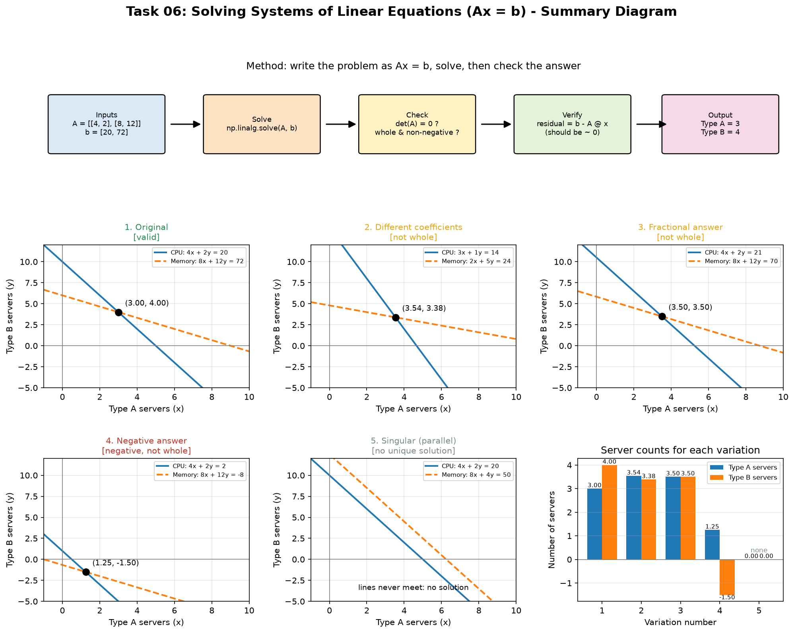
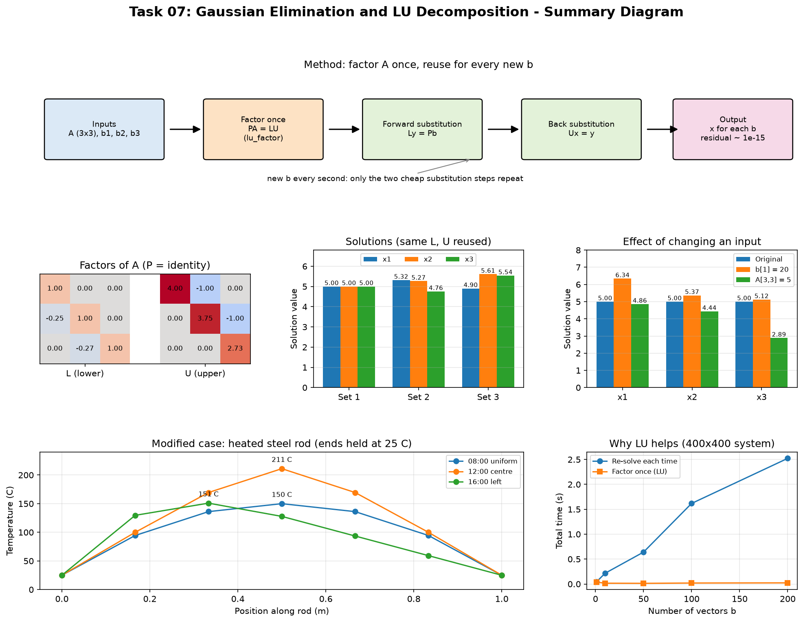
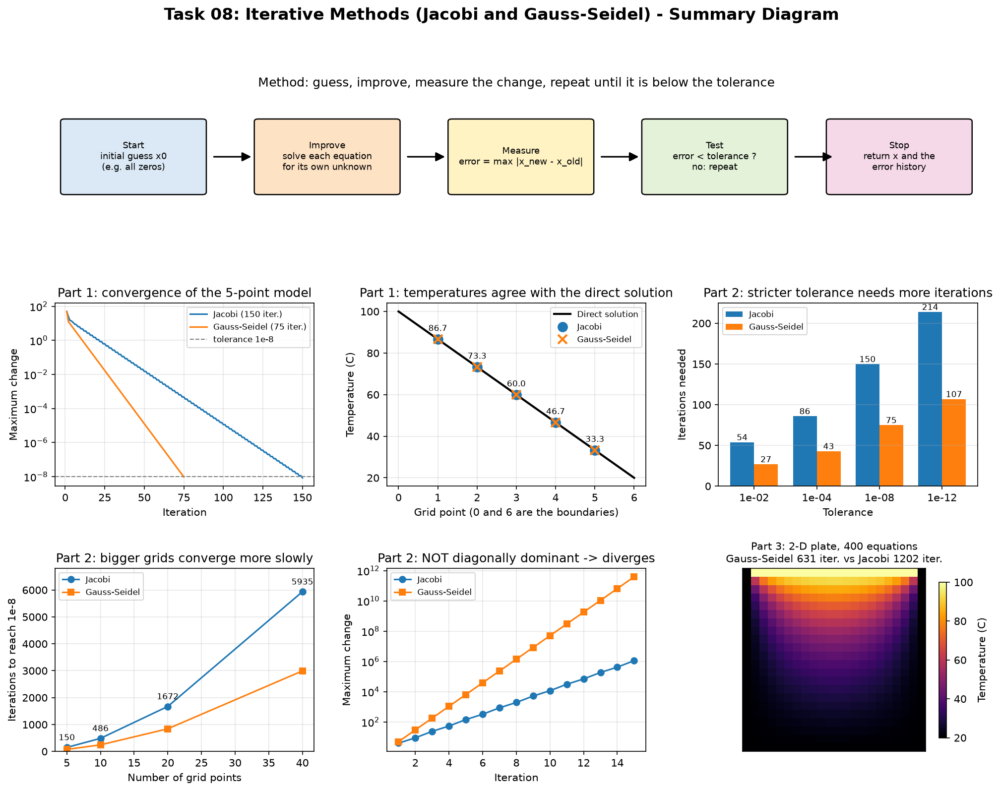
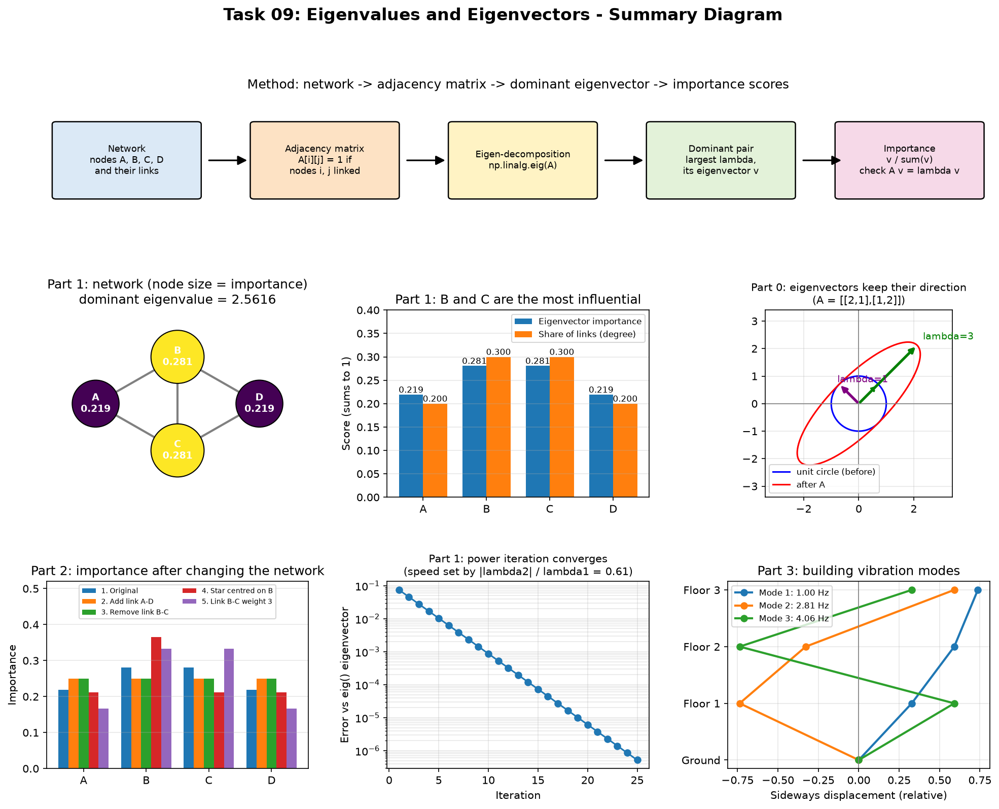
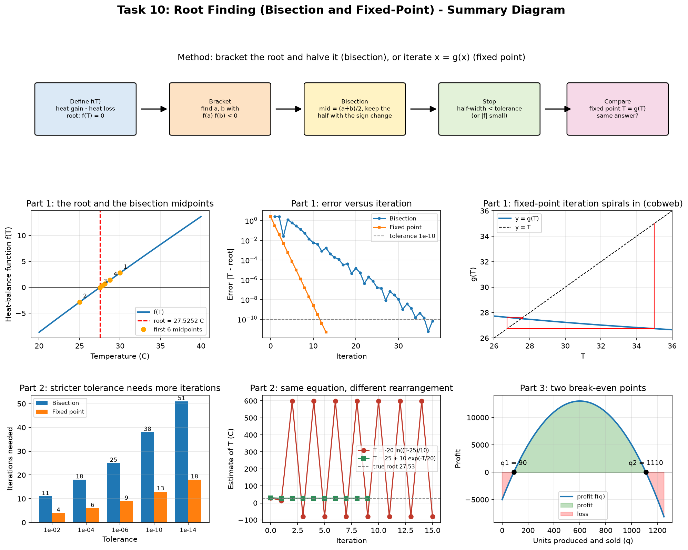

---

## Task B: Mathematical Functions and Vectorization

**Program file:** `code/Task_03_vectorization.py`
**Output graph:** `output/response_time_histogram.png`

### 1. Mathematical Concept

**Vectorization** means applying a mathematical operation to many values at the same time. If `yᵢ = sin²(xᵢ) + cos²(xᵢ)`, the identity gives `yᵢ = 1` for every `xᵢ`. Instead of looping through `x1, x2, ..., xn`, NumPy evaluates the whole vector in one expression. Vectorized code runs in compiled C code inside NumPy, which is why it is so much faster than a Python `for` loop.

### 2. Example

For `x = [0, π/2, π]`, `np.sin(x)` gives approximately `[0, 1, 0]`. The same operation works whether `x` has 3 values or one million values.

### 3. Real-World Applications

Large datasets, simulations, signal processing, image processing, numerical models, and machine learning, where millions of arithmetic operations are repeated.

### 4. Real-World Problem and Solution Approach

**Problem:** A network-monitoring system has one million latency measurements and needs to convert each from milliseconds to seconds and square the values for an error calculation.

**Solution approach:** Use vectorized NumPy expressions such as `seconds = latency_ms / 1000` and `squared = seconds ** 2`. This is simpler and usually much faster than Python loops.

### 5. Solution Code

See `code/Task_03_vectorization.py`. It contains both a loop version and a vectorized version, times them with `timeit`, and checks that they give the same answer.

**Output:**

```
First five squared latency values: [0.03787665 0.01266192 0.04637842 0.03092504 0.00078812]
Loop time: 0.1921 s
Vectorized time: 0.0067 s
Approximate speed-up: 28.5x
Loop and vectorized results match? True
```

**Interpretation:** Both methods give identical results, but the vectorized version is about 28 times faster on one million values (the exact speed-up depends on the computer).

### 6. Changing the Inputs and Observing the Results

| Change made | Result |
|-------------|--------|
| 100 values | Speed-up about 6x (too little data for vectorization to matter much) |
| 10,000 values | Speed-up about 85x |
| 1,000,000 values | Speed-up about 45x |
| Slow network (100 to 900 ms) | Mean squared latency rises from 0.0213 s² to 0.3032 s² |
| One outlier of 10,000 ms | Maximum squared value jumps from 0.0625 s² to 100 s², but the mean barely changes (0.021259 to 0.021359 s²) |
| Constant 100 ms | Every squared value is 0.01 s² |

**Observations:**

- Vectorization helps most on larger datasets. The speed-up varies between runs, but it is always large.
- Squaring magnifies large values, so a single outlier dominates the maximum squared error.
- Because squaring is a nonlinear operation, doubling the latency makes the squared value four times larger.

### 7. Related Real-World Case: Web-Server Response-Time Monitoring

**Scenario:** A web server logs the response time of one million requests. The target is 120 ms, and any response slower than 200 ms breaks the service agreement (SLA).

**Assumptions:**

1. The server logs one million response times in milliseconds.
2. The target response time is 120 ms.
3. Responses over 200 ms break the SLA.
4. Most requests are fast and a few are slow (modelled with a lognormal distribution).

**Approach:** Compute the error from the target, square it, and take the root mean squared error (RMSE), all as vectorized expressions. Use a boolean array (`response_ms > SLA_MS`) to count the slow requests.

**Results:**

```
Mean response time: 116.98 ms
Median response time: 110.08 ms
95th percentile: 195.59 ms
Root mean squared error vs 120 ms target: 42.30 ms
Requests slower than 200 ms: 43,665 (4.37%)
```

**Interpretation:** Only 4.37% of requests exceed 200 ms, so the server is performing acceptably. With a stricter limit of 150 ms, 18.83% of requests would be too slow.


### 8. How to Run

```bash
pip install numpy matplotlib
python code/Task_03_vectorization.py
```


---

## Task C: Floating-Point Arithmetic and Numerical Errors

**Program file:** `code/Task_04_numerical_errors.py`
**Output graph:** `output/roundoff_error_plot.png`

### 1. Mathematical Concept

Computers store most real numbers with a finite number of binary digits, so some values are only approximations.

- **Absolute error** = |true value − approximate value|
- **Relative error** = absolute error / |true value|
- **Truncation error** comes from replacing an exact mathematical process with an approximation.
- **Round-off error** comes from finite computer precision.

### 2. Example

If √2 = 1.41421356 but we use 1.414, the absolute error is about 0.00021356. The relative error is about 0.000151, or 0.0151%.

### 3. Real-World Applications

Scientific simulations, banking calculations, GPS/navigation, engineering design, iterative algorithms, and any system where accumulated numerical error can affect a result.

### 4. Real-World Problem and Solution Approach

**Problem:** A program compares `0.1 + 0.2` with `0.3` and unexpectedly reports `False`.

**Solution approach:** This happens because binary floating-point representation is approximate. Compare using `np.isclose()` or a suitable tolerance instead of exact equality.

### 5. Solution Code

See `code/Task_04_numerical_errors.py`. It shows the failed exact comparison, the tolerance-based fix, the absolute and relative error of an approximation of √2, and an unstable formula next to a stable rewrite of it.

**Output:**

```
0.1 + 0.2 = 0.30000000000000004
Exact comparison: False
Tolerance-based comparison: True
Absolute error: 0.00021356
Relative error: 0.01510114%

x=1e-04: direct=0.499987500624, stable=0.499987500625
x=1e-08: direct=0.499999996961, stable=0.499999998750
x=1e-12: direct=0.500044450291, stable=0.500000000000
```

**Interpretation:** `0.1 + 0.2` is stored as `0.30000000000000004`, so exact equality fails but `np.isclose()` succeeds. The direct formula `(√(1+x) − 1)/x` loses accuracy as `x` shrinks because it subtracts two nearly equal numbers (catastrophic cancellation). The algebraically equivalent form `1/(√(1+x) + 1)` avoids the subtraction and stays accurate.

### 6. Changing the Inputs and Observing the Results

**Other comparisons:**

| Test | Exact `==` | `np.isclose` |
|------|-----------|--------------|
| 0.5 + 0.25 == 0.75 | True | True |
| 0.1 * 3 == 0.3 | False | True |
| ten 0.1s added == 1.0 | False | True |
| 0.1 + 0.7 == 0.8 | False | True |

**Different approximations of √2:**

| Approximation | Absolute error | Relative error |
|---------------|----------------|----------------|
| 1.4 | 0.01421356 | 1.0051% |
| 1.41 | 0.00421356 | 0.2979% |
| 1.414 | 0.00021356 | 0.0151% |
| 1.41421 | 0.00000356 | 0.0003% |

**Unstable formula at more extreme `x`:**

| x | Relative error of direct formula |
|---|----------------------------------|
| 1e-04 | 2.0e-12 |
| 1e-08 | 3.6e-09 |
| 1e-12 | 8.9e-05 |
| 1e-15 | 1.1e-01 (11%) |
| 1e-16 | 1.0 (100%, the answer is 0) |

**Observations:**

- Numbers that are exact in binary (0.5, 0.25, 0.75) compare correctly. Numbers such as 0.1, 0.3 and 0.7 cannot be stored exactly, so exact equality is unreliable for them.
- Each extra correct digit in an approximation reduces the error, but it never reaches zero.
- The direct formula gets worse and worse as `x` shrinks, until at `x = 1e-16` it returns 0 because `1 + x` rounds to exactly 1. The stable formula is unaffected.

### 7. Related Real-World Case: Banking, Adding 10-Cent Payments

**Scenario:** A bank adds up one million payments of exactly $0.10. The exact total is $100,000.00.

**Assumptions:**

1. Every payment is exactly $0.10.
2. The exact total is n × 0.10.
3. Plain floats are compared with integer cents, `Decimal` and `math.fsum`.

**Approach:** Add the payments four different ways and compare each total with the exact value.

**Results:**

```
Plain float sum:      100000.0000013329  (error 1.33e-06)
Integer cents:        100000.0000000000  (error 0.00e+00)
Decimal:              100000.0000000000  (error 0.00e+00)
math.fsum:            100000.0000000000  (error 0.00e+00)
```

**Error of the plain float sum as the number of payments grows:**

| Payments | Error |
|----------|-------|
| 10 | 1.1e-16 |
| 1,000 | 1.4e-12 |
| 100,000 | 1.9e-08 |
| 1,000,000 | 1.3e-06 |

**Interpretation:** A tiny error in each addition accumulates, so the plain float total is wrong by about 0.0000013 dollars after a million payments. This is small, but a bank cannot accept it, and equality checks on the total would fail. Banks avoid it by storing money as integer cents or `Decimal`.


### 8. How to Run

```bash
pip install numpy matplotlib
python code/Task_04_numerical_errors.py
```

## Task D: Matrix Algebra and Matrix Operations

**Program file:** `code/Task_05_matrix_algebra.py`
**Output graph:** `output/task_05_diagram.png`

### 1. Mathematical Concept

A matrix organizes values in rows and columns. Matrix addition combines corresponding elements. Matrix multiplication combines rows of the first matrix with columns of the second: `cᵢⱼ = Σ aᵢₖ bₖⱼ`. The determinant indicates whether a square matrix is invertible (`det = 0` means it is not). The inverse `A⁻¹` satisfies `A A⁻¹ = I`. For a 2-D transformation, `|det|` is also the factor by which areas are multiplied.

### 2. Example

For `A = [[1,2],[3,4]]` and `x = [5,6]`: `Ax = [1×5 + 2×6, 3×5 + 4×6] = [17, 39]`. Also `det(A) = 1×4 − 2×3 = −2`, so `A` is invertible.

### 3. Real-World Applications

Computer graphics transformations, machine learning, cryptography, network models, robotics, electrical circuits and solving systems of equations.

### 4. Real-World Problem and Solution Approach

**Problem:** A graphics program needs to rotate and scale a set of 2-D coordinates representing points on an object.

**Solution approach:** Store the points as coordinate vectors, build a rotation matrix and a scaling matrix, combine them (`T = R @ S`), and multiply every point by `T` so all points are transformed consistently. With points stored as rows, use `points @ T.T`.

### 5. Solution Code

See `code/Task_05_matrix_algebra.py`. It checks the matrix concepts, transforms the four corners of a square (rotate 45°, scale by 2 and 1.5), tests changed inputs, solves an electrical-circuit case, and draws one summary diagram.

**Output:**

```
Part 0: A @ x = [17. 39.]   det(A) = -2.0   A @ inverse(A) = identity
Transformation matrix (rotation @ scale):
[[ 1.4142 -1.0607]
 [ 1.4142  1.0607]]
Transformed points:
[[ 0.      0.    ]
 [ 1.4142  1.4142]
 [ 0.3536  2.4749]
 [-1.0607  1.0607]]
Determinant: 3.0000
```


**Interpretation:** Every point of the square is rotated by 45° and stretched by 2 in one direction and 1.5 in the other. The determinant is 3 (= 2 × 1.5 × 1), so the transformed shape has three times the area of the unit square. Rotation alone never changes area (its determinant is 1), so the area change comes from the scaling.

### 6. Changing the Inputs and Observing the Results

| Change made | Determinant | Result |
|---|---|---|
| Angle 45° → 90° | 3 | Same area. The square turns to a different orientation: corners `(0,0), (0,2), (−1.5,2), (−1.5,0)`. |
| Scale (1, 1), pure rotation | 1 | Same size, only rotated. |
| Scale (2, −1.5) | −3 | The area still grows by 3, but the shape is a mirror image (reflection). |
| Order swapped (`S @ R`) | 3 | Same area but a different shape and position. Matrix multiplication is not commutative. |
| Scale (2, 0) | 0 | The square collapses to a line and the matrix cannot be inverted. |

**Observations:**

- The sign of the determinant shows whether the shape is flipped, and `det = 0` shows the transformation destroys information.
- Order matters: `R @ S ≠ S @ R`.
- When `det ≠ 0`, the inverse matrix undoes the transformation exactly (maximum recovery error about 5×10⁻¹⁷).

### 7. Related Real-World Case: Electrical Circuit (Mesh Currents)

**Scenario:** A circuit with three loops has the resistances and sources below. Mesh-current analysis gives a linear system `R I = V`, which is solved with the same matrix tools.

**Assumptions:**

- Three independent loops with currents I₁, I₂, I₃ in amperes.
- Resistance matrix `R = [[30, −20, 0], [−20, 50, −10], [0, −10, 30]]` ohms.
- Source voltages `V = [10, 0, −5]` volts.

**Results:**

| Case | I₁ | I₂ | I₃ |
|---|---|---|---|
| Original | 0.4333 A | 0.1500 A | −0.1167 A |
| First source 10 V → 20 V | 0.9000 A | 0.3500 A | −0.0500 A |
| R[1,1] 30 → 60 ohm | 0.1806 A | 0.0417 A | −0.1528 A |

**Interpretation:** `det(R) = 30000`, which is non-zero, so there is one unique set of loop currents, and the residual is about 10⁻¹⁵. Doubling the first source raises all the currents, since the loops share resistors. Raising the loop-1 resistance reduces the current in loop 1 most. A negative current means the current flows opposite to the direction chosen for that loop.

### 8. How to Run

```
pip install numpy matplotlib
python code/Task_05_matrix_algebra.py
```

## Task E: Solution of Systems of Linear Equations

**Program file:** `code/Task_06_linear_systems.py`
**Output graph:** `output/task_06_diagram.png`

### 1. Mathematical Concept

Many problems can be written as `Ax = b`, where `A` contains the coefficients, `x` contains the unknowns and `b` contains the known results. Solving the system means finding `x` so that multiplying `A` by `x` reproduces `b`. A unique solution exists when `det(A) ≠ 0`. With two unknowns, each equation is a straight line and the solution is the point where the lines cross.

### 2. Example

`2x + 3y = 8` and `4x + y = 6` become `A = [[2,3],[4,1]]` and `b = [8,6]`. The solution is `x = 1`, `y = 2`, because `2(1) + 3(2) = 8` and `4(1) + 2 = 6`.

### 3. Real-World Applications

Electrical circuit analysis, resource allocation, traffic-flow models, balancing chemical equations, computer graphics and estimating unknown parameters.

### 4. Real-World Problem and Solution Approach

**Problem:** Two server types consume different amounts of CPU and memory. Given the total CPU and memory usage, determine how many servers of each type are active.

**Solution approach:** Let `x` be the number of Type A servers and `y` the number of Type B servers. Form two simultaneous equations from the resource totals and solve `Ax = b` with `np.linalg.solve()`. Verify with `A @ x` and the residual `b − A @ x`.

| | CPU units | Memory (GB) |
|---|---|---|
| Type A | 4 | 8 |
| Type B | 2 | 12 |
| Observed total | 20 | 72 |

`4x + 2y = 20` and `8x + 12y = 72`

### 5. Solution Code

See `code/Task_06_linear_systems.py`. It solves the textbook example and the server problem, tests variations of the input values, handles singular systems, flags answers that are not realistic (fractional or negative server counts), and draws one summary diagram.

**Output:**

```
Type A servers: 3
Type B servers: 4
Verification A @ solution: [20. 72.]
Residual: [0. 0.]
Residual norm: 0.0
```



**Interpretation:** There are 3 Type A servers and 4 Type B servers. Check: CPU = 4(3) + 2(4) = 20 and memory = 8(3) + 12(4) = 72. The residual is zero, so the solution reproduces the observed totals exactly. On the graph, the two lines cross at the point (3, 4).

### 6. Changing the Inputs and Observing the Results

| Variation | Input change | Type A | Type B | Status |
|---|---|---|---|---|
| 1. Original | `b = [20, 72]` | 3 | 4 | Valid |
| 2. Different coefficients | `A = [[3,1],[2,5]]`, `b = [14, 24]` | 3.5385 | 3.3846 | Solved, but not whole |
| 3. Fractional answer | `b = [21, 70]` | 3.5 | 3.5 | Solved, but not whole |
| 4. Negative answer | `b = [2, −8]` | 1.25 | −1.5 | Solved, but not realistic |
| 5. Singular | `A = [[4,2],[8,4]]`, `b = [20, 50]` | none | none | No unique solution |

**Observations:**

- A system can be solved mathematically and still not make sense in the real world. Server counts must be whole, non-negative numbers, so variations 2, 3 and 4 are rejected even though `np.linalg.solve()` returns an answer for them.
- In variation 5, the second row of `A` is exactly twice the first row, so `det(A) = 0`. The two lines are parallel, never cross, and `np.linalg.solve()` raises an error, which the program catches.
- The original `A` has `det = 32`, which is non-zero, so any `b` gives a unique answer. Only the interpretation of that answer can fail.

### 7. Related Real-World Case: Three Server Types (CPU, Memory and Power)

**Scenario:** A data centre runs three server types and records the total CPU, memory and power use. The task is to find how many of each type are active.

**Assumptions:**

- `x`, `y` and `z` are the numbers of Type A, B and C servers.
- Each type uses fixed amounts of CPU, memory and power.
- The observed totals are 22 CPU units, 80 GB memory and 21 power units.

| | CPU | Memory (GB) | Power |
|---|---|---|---|
| Type A | 4 | 8 | 3 |
| Type B | 2 | 12 | 2 |
| Type C | 1 | 4 | 2 |
| Observed total | 22 | 80 | 21 |

**System

## Task F: Gaussian Elimination and LU Decomposition

**Program file:** `code/Task_07_gaussian_lu.py`
**Output graph:** `output/task_07_diagram.png`

### 1. Mathematical Concept

Gaussian elimination transforms `Ax = b` into an equivalent upper-triangular system by removing variables one row at a time, then solves it by back-substitution. LU decomposition writes `PA = LU`, where `L` is lower triangular, `U` is upper triangular and `P` records any row swaps (pivoting). Once `A` is factored, every new `b` is solved in two cheap steps: forward substitution `Ly = Pb`, then back substitution `Ux = y`.

### 2. Example

For `A = [[4,-1,0],[-1,4,-1],[0,-1,3]]` and `b = [15,10,10]`:

- Row 2 ← Row 2 + 0.25 × Row 1 removes x from row 2 and gives `3.75y − z = 13.75`.
- Row 3 ← Row 3 + 0.2667 × Row 2 removes y from row 3 and gives `2.7333z = 13.6667`.
- The last equation gives `z = 5`. Back-substitution gives `y = 5` and `x = 5`.

The multipliers (0.25 and 0.2667) are the entries of `L`, and the reduced matrix is `U`.

### 3. Real-World Applications

Engineering simulations, repeated linear-system solutions, finite-element methods, economic models and scientific models with many equations.

### 4. Real-World Problem and Solution Approach

**Problem:** A simulation uses the same coefficient matrix `A` every second but receives a new measurement vector `b`.

**Solution approach:** Factor `A` once with `lu_factor`. Reuse the factors with `lu_solve` for each new `b`, instead of repeating the full elimination every time.

### 5. Solution Code

See `code/Task_07_gaussian_lu.py`. It factors `A` once, solves three measurement sets, checks the residuals, compares with `np.linalg.solve`, tests changed inputs, solves a heated-rod case, times repeated solves, and draws one summary diagram.

**Output:**

```
L = [[ 1.      0.      0.    ]
     [-0.25    1.      0.    ]
     [ 0.     -0.2667  1.    ]]
U = [[ 4.     -1.      0.    ]
     [ 0.      3.75   -1.    ]
     [ 0.      0.      2.7333]]
Set 1: b = [15. 10. 10.] -> x = [5.     5.     5.    ]  (residual 0)
Set 2: b = [16. 11.  9.] -> x = [5.3171 5.2683 4.7561] (residual 1.8e-15)
Set 3: b = [14. 12. 11.] -> x = [4.9024 5.6098 5.5366] (residual 0)
```



**Interpretation:** Each solution satisfies all

## Task G: Iterative Methods for Linear Systems

**Program file:** `code/Task_08_iterative_linear.py`
**Output graph:** `output/task_08_diagram.png`

### 1. Mathematical Concept

Jacobi and Gauss-Seidel methods start with an initial guess and repeatedly improve it. For each equation, solve for one unknown using the current estimates of the others. Jacobi uses only the old estimates in a sweep, while Gauss-Seidel uses each new value immediately. The process stops when the change between successive estimates is below a chosen tolerance. The methods are guaranteed to converge when the matrix is strictly diagonally dominant.

### 2. Example

If successive estimates of x are 1.0, 1.8, 1.97, 1.999 and 2.000, the values are converging toward 2.

### 3. Real-World Applications

Large sparse systems from heat transfer, electrical networks, structural models, image reconstruction and scientific simulations where direct matrix factorization may be expensive.

### 4. Real-World Problem and Solution Approach

**Problem:** A grid model of temperatures produces thousands of linear equations, most of whose coefficients are zero.

**Solution approach:** Use an iterative method such as Jacobi or Gauss-Seidel. Track the error in each iteration (the maximum change in any unknown) and stop once it falls below the tolerance.

### 5. Solution Code

See `code/Task_08_iterative_linear.py`. It solves a 5-point temperature model with both methods, compares them with the direct solution, tests changed inputs, solves a 2-D plate case, and draws one summary diagram.

**Model:** five interior grid points, left boundary 100 °C, right boundary 20 °C, `A = tridiag(−1, 2, −1)` and `b = [100, 0, 0, 0, 20]`.

**Output:**

```
Jacobi temperatures       : [86.6667 73.3333 60. 46.6667 33.3333]   (150 iterations)
Gauss-Seidel temperatures : [86.6667 73.3333 60. 46.6667 33.3333]   (75 iterations)
Direct solution           : [86.6667 73.3333 60. 46.6667 33.3333]
Max difference Jacobi vs direct       : 3.41e-08
Max difference Gauss-Seidel vs direct : 2.89e-08
```



**Interpretation:** Both methods reach the direct solution, and the temperature falls in a straight line from 100 °C to 20 °C across the grid. The error drops steadily at each iteration. Gauss-Seidel needs 75 iterations while Jacobi needs 150, about half as many, because it reuses the newest values straight away. The remaining difference of about 10⁻⁸ equals the tolerance.

### 6. Changing the Inputs and Observing the Results

| Change made | Result |
|---|---|
| Tolerance 10⁻² → 10⁻⁴ → 10⁻⁸ → 10⁻¹² | Jacobi: 54, 86, 150, 214 iterations. Gauss-Seidel: 27, 43, 75, 107. |
| Starting guess all zeros → all 60 | Jacobi needs 32 iterations instead of 150. Starting at the exact answer needs 1. |
| Boundaries 100/20 → 200/50 | Gauss-Seidel gives `[175, 150, 125, 100, 75]` in 78 iterations. |
| Grid of 5, 10, 20, 40 points | Jacobi: 150, 486, 1672, 5935 iterations. Gauss-Seidel: 75, 245, 842, 2993. |
| `A = [[1,2],[3,1]]`, `b = [3,4]` (not diagonally dominant) | Both methods diverge. The change grows from 144 to 11 664 to 1 119 744 (Jacobi, at iterations 5, 10 and 15). The direct solution `[1, 1]` works fine. |

**Observations:**

- A stricter tolerance costs more iterations, but only by a roughly constant amount for each extra digit of accuracy.
- A good starting guess saves work.
- Bigger grids converge more slowly, so very large problems need many iterations.
- Gauss-Seidel needs about half the iterations of Jacobi in every test.
- Diagonal dominance matters. Without it, an iterative method can blow up, even though the system itself has a solution.

### 7. Related Real-World Case: Temperature of a 2-D Heated Metal Plate

**Scenario:** A square metal plate has its top edge held at 100 °C and its other three edges at 20 °C. We want the steady-state temperature at every interior point. Each point's temperature is the average of its four neighbours, which gives one equation per grid point.

**Assumptions:**

- Steady state, no heat sources inside the plate, uniform material.
- 20 × 20 interior grid, so 400 unknowns and a 400 × 400 matrix.
- The 5-point Laplace stencil (each row has a 4 on the diagonal and four −1 entries), so about 98.8% of the coefficients are zero.
- Tolerance 10⁻⁶.

**Results:**

| Method | Iterations | Max error vs direct solution |
|---|---|---|
| Jacobi | 1202 | 8.8 × 10⁻⁵ |
| Gauss-Seidel | 631 | 4.4 × 10⁻⁵ |

The hottest interior point is 92.30 °C, next to the 100 °C edge, and the centre of the plate is 38.42 °C.

**Interpretation:** The heatmap shows heat spreading from the hot top edge, with temperatures dropping toward the cooler edges. Because the matrix is almost entirely zeros, each iteration only needs the four neighbours of each point. For plates with thousands or millions of points, this is much cheaper than a direct factorisation, which is why iterative methods are used for large sparse systems. Gauss-Seidel again needs about half the iterations of Jacobi.

### 8. How to Run

```
pip install numpy matplotlib
python code/Task_08_iterative_linear.py
```

## Task H: Eigenvalues and Eigenvectors

**Program file:** `code/Task_09_eigenvalues.py`
**Output graph:** `output/task_09_diagram.png`

### 1. Mathematical Concept

For a square matrix `A`, an eigenvector `v` is a non-zero vector whose direction is unchanged by the transformation `A`. It satisfies `Av = λv`, where `λ` is the eigenvalue. The eigenvalue tells how much the vector is stretched, compressed or reversed. For a connected network, the eigenvector of the largest eigenvalue (the dominant eigenvector) has all positive entries and can be used as a measure of node importance.

### 2. Example

If `Av = 3v`, then `v` is an eigenvector and 3 is its eigenvalue. Applying `A` triples the magnitude of `v` without changing its direction. For `A = [[2,1],[1,2]]` and `v = [1,1]`: `Av = [3,3] = 3v`.

### 3. Real-World Applications

Google PageRank concepts, vibration analysis, stability of dynamical systems, principal component analysis, image compression, quantum models and network centrality.

### 4. Real-World Problem and Solution Approach

**Problem:** A small computer network needs to identify which nodes are structurally most influential from their pattern of connections.

**Solution approach:** Represent the network as an adjacency matrix, compute its dominant eigenvalue and eigenvector with `np.linalg.eig`, and normalize the dominant eigenvector so the scores add up to 1. This gives an eigenvector-based node-importance measure. Verify the result with `Av = λv`.

### 5. Solution Code

See `code/Task_09_eigenvalues.py`. It checks the eigenvector idea on a small matrix, computes the importance of each node, tests changed networks, solves a building-vibration case, and draws one summary diagram.

**Network:** nodes A, B, C, D with links A–B, A–C, B–C, B–D and C–D. A and D have 2 links each, and B and C have 3 each.

**Output:**

```
All eigenvalues: [ 2.5616 -0.     -1.     -1.5616]
Dominant eigenvalue: 2.5616
Eigenvector-based importance:
   A: 0.2192   (number of links = 2)
   B: 0.2808   (number of links = 3)
   C: 0.2808   (number of links = 3)
   D: 0.2192   (number of links = 2)
Verification error ||A v - lambda v||: 1.51e-15
```



**Interpretation:** The dominant eigenvalue is 2.5616. B and C are the most influential nodes (0.2808 each), and A and D are less influential (0.2192 each), which matches the network, where B and C have the most links. The importance score is not just the link count: a node scores higher when its neighbours are themselves well connected. The verification error is about 10⁻¹⁵, so `Av = λv` holds to machine precision. The graph also shows that power iteration (repeatedly multiplying by `A`) finds the same vector without calling `eig`.

### 6. Changing the Inputs and Observing the Results

| Change made | Dominant eigenvalue | Importance (A, B, C, D) | Result |
|---|---|---|---|
| Original network | 2.5616 | 0.219, 0.281, 0.281, 0.219 | B and C lead. |
| Add link A–D | 3.0000 | 0.25 each | Every node now has 3 links, so all are equal. |
| Remove link B–C | 2.0000 | 0.25 each | The network is a 4-node ring, so all are equal. |
| Star centred on B | 1.7321 | 0.211, 0.366, 0.211, 0.211 | B is clearly the most influential. |
| Link B–C weight 3 | 4.0000 | 0.167, 0.333, 0.333, 0.167 | B and C gain even more importance. |
| Disconnected (A–B and C–D only) | 1 (repeated) | not meaningful | The eigenvector is not unique. |

**Observations:**

- Adding links raises the dominant eigenvalue (2.56 → 3.00), and removing links lowers it (2.56 → 2.00).
- When every node is equivalent, the scores are equal.
- In a star, the hub gets the highest score.
- For a disconnected network the dominant eigenvalue is repeated, so the importance scores are not defined.
- Eigenvectors can come out with either sign, so the code flips the sign and uses absolute values.

### 7. Related Real-World Case: Vibration of a 3-Storey Building

**Scenario:** A structural engineer needs the natural frequencies and vibration shapes of a three-storey building, to check them against earthquake or wind frequencies. These come from an eigenvalue problem `(K/m) v = ω² v`.

**Assumptions:**

- Three floors, each with a mass of 10 000 kg, connected by springs of stiffness 2 × 10⁶ N/m.
- Linear behaviour, sideways motion only, no damping.
- Stiffness matrix `K = 2×10⁶ × [[2,−1,0],[−1,2,−1],[0,−1,1]]`.
- The eigenvalues of `K/m` are ω² (in rad²/s²), and the frequency is `f = ω / 2π`.

**Results:**

| Mode | ω² | Frequency | Shape (floors 1, 2, 3) |
|---|---|---|---|
| 1 | 39.61 | 1.002 Hz | 0.328, 0.591, 0.737 |
| 2 | 310.99 | 2.807 Hz | −0.737, −0.328, 0.591 |
| 3 | 649.40 | 4.056 Hz | 0.591, −0.737, 0.328 |

Doubling the stiffness multiplies every frequency by √2 (1.002 → 1.417 Hz for mode 1). Doubling the floor mass divides every frequency by √2 (1.002 → 0.708 Hz).

**Interpretation:** The lowest mode (1.00 Hz) has all floors moving the same way, with the top floor moving most. This is the mode most easily excited by wind or earthquakes. Higher modes have floors moving in opposite directions and vibrate faster. A stiffer building vibrates faster and a heavier building vibrates slower, which is why engineers change stiffness or mass to move the natural frequencies away from dangerous forcing frequencies.

### 8. How to Run

```
pip install numpy matplotlib
python code/Task_09_eigenvalues.py
```

## Task I: Root Finding: Bisection and Fixed-Point Methods

**Program file:** `code/Task_10_bisection_fixed_point.py`
**Output graph:** `output/task_10_diagram.png`

### 1. Mathematical Concept

A root of `f(x)` is a value `r` for which `f(r) = 0`. Bisection starts with an interval `[a, b]` where `f(a)` and `f(b)` have opposite signs, repeatedly halves the interval and keeps the half that contains a root. Fixed-point iteration rewrites the equation as `x = g(x)` and repeatedly calculates `xₙ₊₁ = g(xₙ)`. Bisection always converges once a root is bracketed, but slowly. Fixed-point iteration is faster when it converges, but only if `|g′(x)| < 1` near the root.

### 2. Example

For `f(x) = x³ − x − 2`, `f(1) = −2` and `f(2) = 4`, so a root lies between 1 and 2. The first midpoints are 1.5, 1.75, 1.625, 1.5625, ... and they close in on the root 1.521380.

### 3. Real-World Applications

Finding break-even points, solving engineering equations, computing interest rates, calibration, physical equilibrium and threshold values.

### 4. Real-World Problem and Solution Approach

**Problem:** Determine the temperature at which a nonlinear heat-balance equation becomes zero.

**Solution approach:** Define the heat-balance function `f(T) = T − 25 − 10·exp(−T/20)`, bracket a sign change in `[20, 40]` and apply the bisection method. Stop when the interval or the function value is sufficiently small. As a check, rewrite the equation as `T = 25 + 10·exp(−T/20)` and use fixed-point iteration.

### 5. Solution Code

See `code/Task_10_bisection_fixed_point.py`. It writes out both methods, compares them with `scipy`, tests changed inputs, solves a break-even case, and draws one summary diagram.

**Output:**

```
f(20) = -8.6788, f(40) = 13.6466  -> sign change in [20, 40]
Bisection (own code)     : 27.525211 C   (38 iterations)
Bisection (scipy)        : 27.525211 C   (38 iterations)
Fixed-point iteration    : 27.525211 C   (13 iterations)
Check f(root) = -7.55e-11
|g'(T)| at the root = 0.126  (< 1, so fixed-point iteration converges)
```



**Interpretation:** The heat balance is zero at an equilibrium temperature of 27.5252 °C, and both methods agree. Bisection needs 38 halvings, because each step only gains one binary digit of accuracy. Fixed-point iteration needs only 13 steps, because `|g′(T)| ≈ 0.126` at the root, so each step cuts the error by about a factor of 8. On the cobweb graph, the iteration spirals into the point where `g(T)` crosses the line `y = T`.

### 6. Changing the Inputs and Observing the Results

| Change made | Result |
|---|---|
| Tolerance 10⁻² → 10⁻⁴ → 10⁻⁶ → 10⁻¹⁰ → 10⁻¹⁴ | Bisection: 11, 18, 25, 38, 51 iterations. Fixed point: 4, 6, 9, 13, 18. |
| Bracket `[20, 40]` → `[0, 100]` | 38 → 40 iterations. A wider bracket costs only a little extra. |
| Fixed-point start 25, 30, 100 | Same answer (27.525211 °C) in 13, 13 and 14 iterations. |
| Bracket `[30, 40]` (no sign change) | The code raises a `ValueError`, because no root is guaranteed. |
| Different rearrangement `T = −20 ln((T−25)/10)` | Does not converge. The values jump between about −81 and 599 (`|g′| ≈ 7.9 > 1`). |
| Stronger heat source (10 → 40) | Root moves to 32.7706 °C. Bisection 39 iterations, fixed point 27. |

**Observations:**

- Each extra digit of accuracy costs bisection about 3.3 more halvings, because the interval halves every time.
- Fixed-point iteration is faster, but only for a rearrangement with `|g′| < 1`. The same equation can converge or fail depending on how it is rewritten.
- Bisection needs a sign change, and it fails safely with an error when there isn't one.
- The starting guess hardly matters when fixed point converges.
- A stronger heat source makes `|g′|` larger, so fixed point needs more steps (27 instead of 13).

### 7. Related Real-World Case: Break-Even Points of a Business

**Scenario:** A company sells `q` units. The price falls as volume grows, so revenue is `R(q) = 80q − 0.03q²`. The cost is `C(q) = 5000 + 20q + 0.02q²`. The break-even points are where profit `f(q) = R(q) − C(q) = 60q − 0.05q² − 5000` equals zero.

**Assumptions:**

- Every unit produced is sold.
- Prices and costs follow the formulas above.
- There are two break-even points, so each is bracketed separately: `[0, 500]` and `[500, 1500]`.
- Tolerance 10⁻⁸.

**Results:**

| Method | q₁ (lower) | q₂ (upper) |
|---|---|---|
| Bisection | 90.0980 units | 1109.9020 units |
| Exact (quadratic formula) | 90.0980 units | 1109.9020 units |

The company makes a profit between about 90 and 1110 units. The most profitable volume is 600 units, with a profit of 13 000.

**Interpretation:** Below 90 units the fixed costs are not covered, and above 1110 units the falling price and rising cost wipe out the profit again. Bisection finds both roots as long as each is bracketed. Fixed-point iteration `q = (5000 + 0.05q²)/60` finds only the lower root (in 16 steps from `q₀ = 200`). From `q₀ = 1200` it runs away, because `|g′|` is larger than 1 at the upper root. This shows why bisection is the safer method when there are several roots.

### 8. How to Run

```
pip install numpy scipy matplotlib
python code/Task_10_bisection_fixed_point.py
```

## Task J (Task 11): Root Finding with Newton-Raphson and Secant Methods

**Program:** `code/Task_11_newton_secant.py`
**Outputs:** `output/task_11_output.txt`, `output/task_11_diagram.png`

### A. Concept
Newton-Raphson improves a guess using x(n+1) = x(n) - f(x(n)) / f'(x(n)). It follows the tangent line toward the root. The secant method does the same but estimates the slope from the two latest points, so no derivative is needed. Both usually converge much faster than bisection when started well.

**Problem:** A project costs 10,000 now and returns 3,000, 3,500, 4,000 and 2,500 at the end of years 1 to 4. Find the interest rate (the internal rate of return, IRR) that makes the net present value (NPV) equal to zero.

### B. Input values and mathematical operation

| Input | Value | Meaning |
|---|---|---|
| `cash_flows` | `[-10000, 3000, 3500, 4000, 2500]` | investment at t = 0, then yearly inflows |
| Newton start `x0` | 0.10 | first guess (10%) |
| Secant starts `x0`, `x1` | 0.05 and 0.20 | two first guesses |
| `xtol` | 1e-12 | stopping tolerance |

- NPV(r) = sum of CF(t) / (1 + r)^t. This is the function f(r) whose root is wanted.
- d_npv(r) = sum of -t * CF(t) / (1 + r)^(t+1). This is f'(r), used by Newton.
- Newton repeats r_new = r - NPV(r) / d_npv(r).
- Secant repeats r_new = r(n) - NPV(r(n)) * (r(n) - r(n-1)) / (NPV(r(n)) - NPV(r(n-1))).

Check by hand: NPV(0.10) = 332.63 and d_npv(0.10) = -22,143.92, so the first Newton step gives